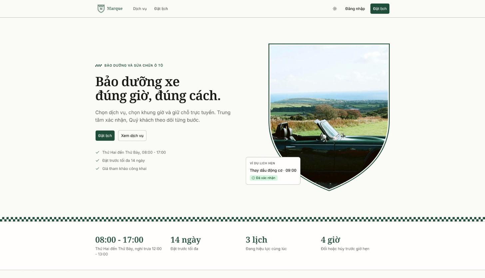
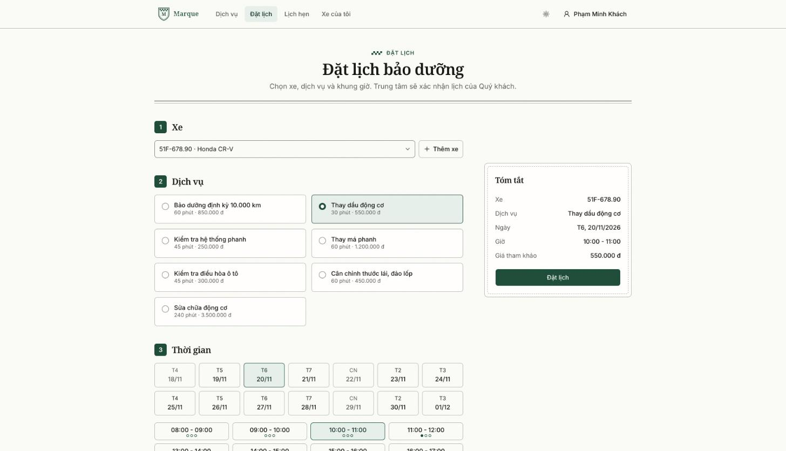
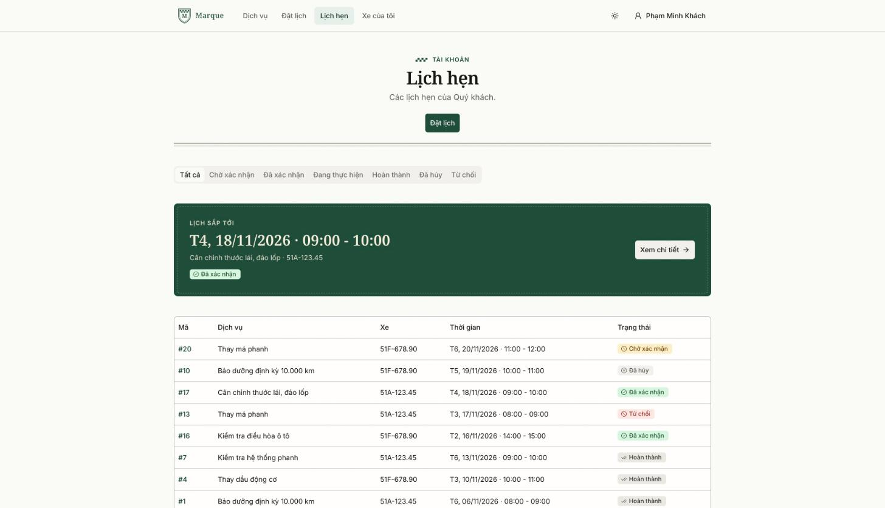
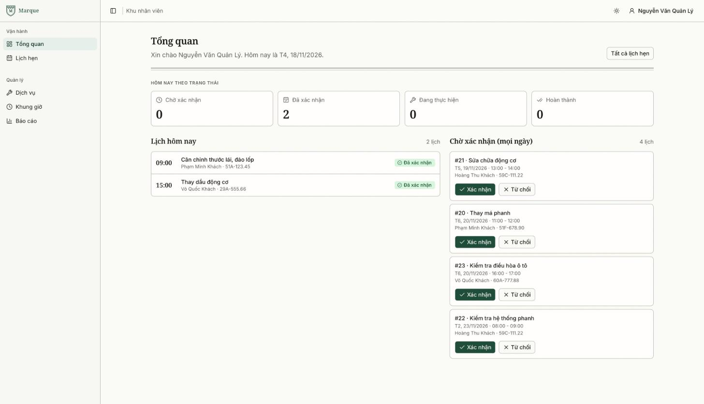
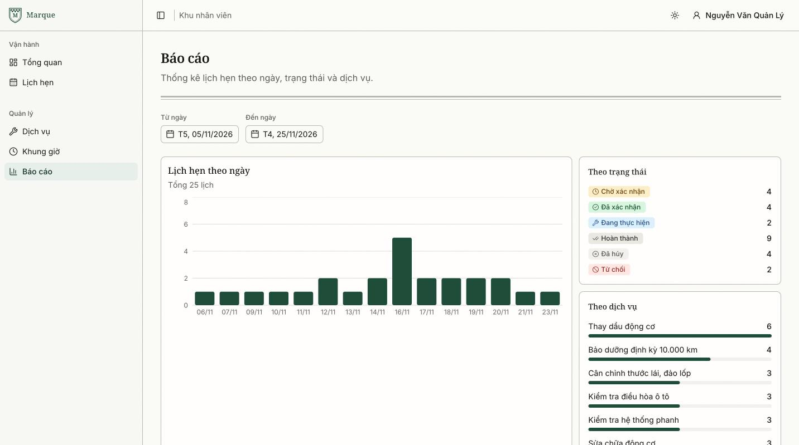

<div align="center">
  

  <p><a href="https://marque.phren.dev"><strong>Bản chạy trực tuyến</strong></a> · <a href="#dùng-thử">Dùng thử</a> · <a href="#chức-năng">Chức năng</a> · <a href="#chạy-trên-máy">Chạy trên máy</a> · <a href="docs/api/">API</a> · <a href="https://github.com/trvux/qldapm-datlich/releases/tag/v1.0">Release v1.0</a> · <a href="https://trello.com/b/hfSS40aF">Trello</a></p>

  <p>
    <a href="https://marque.phren.dev"></a> <a href="https://github.com/trvux/qldapm-datlich/releases/tag/v1.0"></a> <a href="https://github.com/trvux/qldapm-datlich/tree/main/backend/tests"></a> <a href="LICENSE"></a> <a href="https://github.com/trvux/qldapm-datlich/commits/main"></a> <a href="https://trello.com/b/hfSS40aF"></a>
  </p>

  <p>
            
  </p>

  <a href="https://marque.phren.dev">
    
  </a>
</div>

# Marque: hệ thống đặt lịch bảo dưỡng và sửa chữa ô tô

Hệ thống web cho khách đặt lịch bảo dưỡng và sửa chữa ô tô trực tuyến, cho nhân viên tiếp nhận và xử lý lịch hẹn, cho quản lý xem báo cáo thống kê. Đồ án môn **Quản lý dự án phần mềm** (71ITSE41503, lớp 261_71ITSE41503_01, học kỳ 1 năm học 2026-2027, Trường Đại học Văn Lang), làm theo Scrum trong 3 Sprint, 3 tuần.

> **Bản chạy trực tuyến: <https://marque.phren.dev>**
>
> **Marque** là tên thương hiệu nhóm đặt cho hệ thống. **Trung tâm Dịch vụ Ô tô XYZ** là tên khách hàng trong đề bài; tên này còn xuất hiện trong tài liệu API và dữ liệu mẫu (`@xyz.vn`). Hai tên chỉ cùng một dự án.

## Điểm nổi bật

- **Không đặt vượt chỗ.** Mỗi khung giờ nhận tối đa 3 xe. Kiểm tra và lưu lịch nằm trong một transaction có khóa dòng, nên hai người tranh chỗ cuối cùng chỉ một người được nhận (có test đồng thời).
- **Ba vai trò, một hệ thống.** Khách, nhân viên, quản lý thấy đúng màn hình và quyền của mình; tài khoản bị khóa trả 403.
- **Đổi, hủy lịch có quy tắc.** Tối đa 2 lần đổi, chặn theo thời gian, trả chỗ trống ngay khi hủy hoặc từ chối.
- **Báo cáo khớp số.** Ba bảng thống kê theo ngày, trạng thái, dịch vụ luôn có cùng tổng.
- **Thử bằng dữ liệu thật.** 170 test tự động chạy trên PostgreSQL thật, cộng 12 test case chính thức (11 đạt, 1 bỏ qua có test thay thế).
- **Dùng được trên mọi màn hình.** Giao diện Marque đã kiểm ở 390, 820 và 1440 px, có chế độ sáng và tối.
- **Có hồ sơ dự án đi kèm.** Làm theo Scrum, theo dõi bằng Trello và EVM; kết quả, bài học và các lỗi đã gặp ghi trung thực trong hồ sơ nộp.

## Màn hình

Ảnh chụp từ bản chạy thật (1440 px), dữ liệu mẫu của repo.

<table>
  <tr>
    <td width="50%"><br><sub><b>Khách đặt lịch.</b> Chọn xe, dịch vụ, khung giờ; ô khung giờ hiện số chỗ còn lại.</sub></td>
    <td width="50%"><br><sub><b>Khách theo dõi lịch hẹn.</b> Lọc theo 6 trạng thái, lịch sắp tới nổi bật.</sub></td>
  </tr>
  <tr>
    <td width="50%"><br><sub><b>Nhân viên, quản lý.</b> Lịch hôm nay và hàng chờ xác nhận hoặc từ chối.</sub></td>
    <td width="50%"><br><sub><b>Quản lý xem báo cáo.</b> Ba bảng theo ngày, trạng thái, dịch vụ cùng một tổng.</sub></td>
  </tr>
</table>

## Dùng thử

Mở <https://marque.phren.dev/dang-nhap>, bấm một nút tài khoản demo hoặc nhập tay:

| Vai trò | Email | Mật khẩu | Làm được gì |
|---|---|---|---|
| Khách hàng | `khach1@example.com` | `Customer@123` | Xem dịch vụ, đặt, đổi, hủy lịch, theo dõi trạng thái, quản lý xe |
| Nhân viên | `staff1@xyz.vn` | `Staff@1234` | Xác nhận, từ chối, bắt đầu, hoàn tất lịch hẹn |
| Quản lý | `manager@xyz.vn` | `Manager@123` | Thêm hoặc ngừng dịch vụ, chỉnh sức chứa khung giờ, xem báo cáo |

Đây là dữ liệu mẫu công khai, không dùng cho dữ liệu thật.

## Chức năng

Chín chức năng F01 đến F09 theo đề bài; chức năng nào cũng có quy tắc nghiệp vụ (BR) và test tương ứng.

| Mã | Chức năng | Ai dùng |
|---|---|---|
| F01 | Quản lý danh mục dịch vụ (thêm, sửa, ngừng hoạt động) | Quản lý |
| F02 | Tra cứu dịch vụ | Mọi người |
| F03 | Đặt lịch trực tuyến, chọn dịch vụ, xe, ngày, khung giờ | Khách |
| F04 | Xử lý lịch hẹn: xác nhận, từ chối kèm lý do, bắt đầu, hoàn tất | Nhân viên |
| F05 | Đổi lịch (tối đa 2 lần) và hủy lịch | Khách |
| F06 | Theo dõi trạng thái lịch hẹn và nhật ký chuyển trạng thái | Khách, nhân viên |
| F07 | Quản lý sức chứa khung giờ, chống đặt vượt chỗ | Hệ thống, quản lý |
| F08 | Báo cáo thống kê theo ngày, trạng thái, dịch vụ | Quản lý |
| F09 | Đăng nhập và phân quyền theo vai trò | Tất cả |

Quy tắc chính: mỗi ngày có 8 khung giờ 1 tiếng (nghỉ trưa 12:00 đến 13:00), mỗi khung nhận tối đa 3 xe, đặt được trong 14 ngày tới từ thứ Hai đến thứ Bảy, mỗi khách có tối đa 3 lịch đang hiệu lực. Đặt lịch kiểm tra và lưu trong một transaction có khóa dòng nên hai người tranh chỗ cuối cùng chỉ một người được nhận.

## Công nghệ

| Phần | Công nghệ | Thư mục |
|---|---|---|
| Backend | Python 3.13, FastAPI, psycopg (pool), PyJWT, Argon2id | [`backend/`](backend/) |
| Cơ sở dữ liệu | PostgreSQL 18 (7 bảng, 1 chỉ mục duy nhất chống đặt trùng xe) | [`backend/db/`](backend/db/) |
| Giao diện Marque | Next.js 16, React 19, Tailwind CSS 4, shadcn/ui, bun | [`web/`](web/) |
| Giao diện bản v1.0 | HTML, CSS, JavaScript thuần (giữ lại để đối chiếu bản nộp) | [`frontend/`](frontend/) |
| API | 18 đường dẫn, 22 thao tác; đặc tả ở [`docs/api/`](docs/api/) | |

Web gọi API qua đường dẫn cùng nguồn `/api` (Next chuyển tiếp sang Backend) nên không dính CORS.

## Chạy trên máy

Cần Docker, [uv](https://docs.astral.sh/uv/), Python 3.13 trở lên và [bun](https://bun.sh).

```bash
# 1. Backend + PostgreSQL (cổng 8000 và 5434)
cd backend
cp .env.example .env          # đổi JWT_SECRET thành chuỗi ngẫu nhiên
docker compose up -d          # PostgreSQL 18, tự nạp schema và dữ liệu mẫu
uv sync
uv run uvicorn app.main:app --reload     # Swagger: http://localhost:8000/docs
```

```bash
# 2. Giao diện Marque (cửa sổ terminal khác)
cd web
bun install
bun run dev -p 3100           # http://localhost:3100
```

Giao diện bản v1.0 (HTML thuần): `cd frontend && python3 run_frontend.py` rồi mở <http://localhost:3000>. Nếu đổi cổng thì thêm địa chỉ đó vào `CORS_ORIGINS` trong `backend/.env`. Chi tiết từng phần: [`backend/README.md`](backend/README.md), [`web/README.md`](web/README.md), [`frontend/README.md`](frontend/README.md).

## Kiểm thử

```bash
cd backend && uv run pytest -q
```

- **170 test tự động** trên nhánh `main` (169 tại bản v1.0), chạy trên PostgreSQL thật qua HTTP, có test đồng thời (hai yêu cầu tranh chỗ cuối cùng nhận 201 và 409) và kiểm tra chèn lỗi cố ý.
- **12 test case chính thức**: chạy lại ngày 15/11/2026, 11 đạt, 1 bỏ qua (TC03, khung giờ đã qua không có trong CSDL, có test tự động thay thế), 0 lỗi. Kết quả và ảnh minh chứng ở [`docs/sprint3/`](docs/sprint3/).

## Phiên bản

| | Bản `v1.0` (mốc nộp đồ án) | Nhánh `main` |
|---|---|---|
| Commit | `5760bc9` | mới nhất |
| API | 17 đường dẫn, 21 thao tác | 18 đường dẫn, 22 thao tác (thêm `GET /policy`) |
| Giao diện | `frontend/` HTML thuần | `web/` Next.js (thương hiệu Marque), kèm `frontend/` |
| Test Backend | 169 | 170 |

Gói mã nguồn bàn giao: [Release v1.0](https://github.com/trvux/qldapm-datlich/releases/tag/v1.0). Các mốc Sprint có tag `sprint-2`, `sprint-3`.

## Cấu trúc repo

```
backend/    FastAPI + PostgreSQL: app/, db/ (schema, dữ liệu mẫu), tests/, scripts/
web/        Giao diện Marque (Next.js): khu khách và khu admin
frontend/   Giao diện bản v1.0 (HTML thuần)
docs/
  assets/   Banner
  api/      Đặc tả API Backend - Frontend + openapi.json
  sprint2/  Tài liệu Sprint 2
  sprint3/  Kết quả Backend, chạy test case, kịch bản demo, evidence/ (ảnh, kết quả chạy)
  testing/  Báo cáo sửa lỗi Frontend
```

## Nhóm và cách làm việc

| Thành viên | Vai trò |
|---|---|
| Huỳnh Bảo Huy (trưởng nhóm) | Product Owner, Backend và cơ sở dữ liệu |
| Nguyễn Minh Quang | Scrum Master, tài liệu quản lý dự án, kiểm thử |
| Trần Ngọc Tôn Tri | Frontend và chất lượng |

- Theo dõi tiến độ trên [Trello](https://trello.com/b/hfSS40aF): mỗi thẻ là một việc, số `#NN` trong tên thẻ là số thứ tự trong bảng phân công 52 việc.
- Quy ước branch, commit, Pull Request: [`CONTRIBUTING.md`](CONTRIBUTING.md).
- Tài liệu quản lý dự án (Charter, WBS, EVM, Risk Register, Lessons Learned...) nằm trong hồ sơ nộp của nhóm, không để trong repo này.

## Giới hạn đã biết

- Nhắc lịch bằng SMS (Change Request #28, PB21) **chưa làm**, đã hoãn sang Release 2; đề cũng không cho phép dùng dịch vụ SMS thương mại.
- Hệ thống chạy với dữ liệu mẫu; chưa có đăng ký tài khoản khách tự phục vụ.

## Giấy phép và nguồn ảnh

Mã nguồn phát hành theo giấy phép [MIT](LICENSE), bản quyền thuộc Nhóm 3 (Huỳnh Bảo Huy, Nguyễn Minh Quang, Trần Ngọc Tôn Tri). Ảnh minh họa trên web lấy từ Unsplash và theo giấy phép của Unsplash, ghi nguồn ở [`web/public/images/CREDITS.md`](web/public/images/CREDITS.md).
